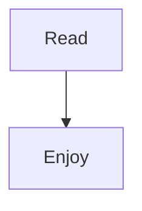

# Welcome

A quiet **Markdown** reader.

## Features

[Read the guide](nested/guide.md#repeat)

[Unicode notes](nested/%E7%8C%AB%20notes.md#猫-notes)


| Feature | Supported |
| ------- | --------- |
| Tables  | Yes       |

- [x] Task lists
- [ ] Read another page

```ts
const message: string = 'hello'
```

Inline math $x^2 + y^2$.

$$
\sum_{n=1}^{5} n
$$



## Repeat

First.

## Repeat

Second.
