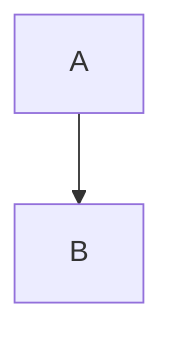

# Untrusted content

<script>window.__compromised = true</script>


[Unsafe link](javascript:window.__compromised=true)

$\href{javascript:window.__compromised=true}{Unsafe math}$




```mermaid
not a valid diagram
```

## Still readable

The rest of the document survives.
